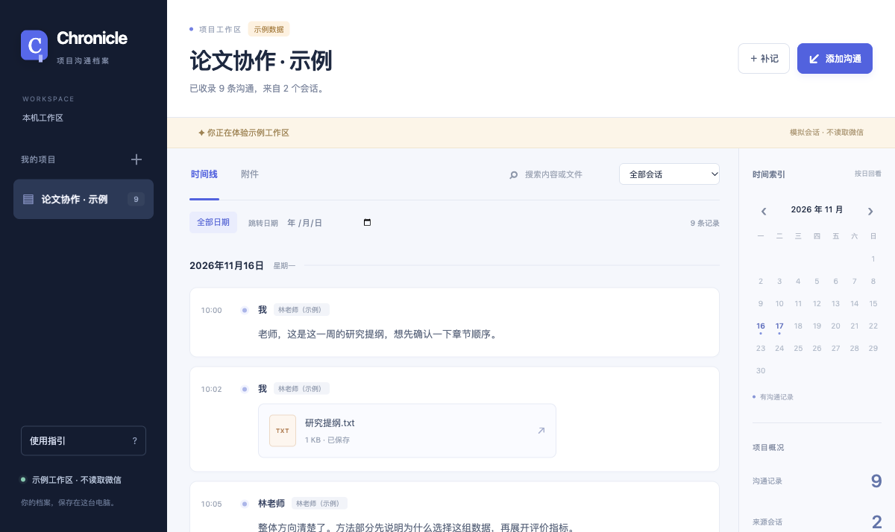

# Chronicle

[English](README.md) · [简体中文](README.zh-CN.md)

**Keep a project's conversations together.**

A decision in a private chat. A document in a group. A voice message with the missing context. Chronicle brings the relevant pieces into one local project archive, ordered by when they happened.



Create a project → select messages across WeChat conversations → revisit the timeline and attachments.

## What it does

- Browse local WeChat conversations and choose relevant messages inside the workbench.
- Merge private chats and groups into a project timeline, with dates, senders, source labels, search and duplicate protection.
- Copy available files, images, video and original voice into the archive. Missing resources stay visibly missing.
- Play decoded voice, add or correct its text, and use an optional transcription adapter when you configure a provider.
- Preserve a lightweight quoted-message snapshot alongside the reply. No recursive import of unrelated history.
- Add manual notes and files for conversations outside WeChat.
- Guide first-time users through three steps; explore an isolated demo before connecting an account.

**Early development, source-first.** The supported connection target is macOS on Apple Silicon; the current adapter was tested with WeChat 4.1.15. Other versions and Intel Macs need validation. The archive core is platform-independent; Windows connection work is planned separately. The interface currently uses Simplified Chinese. DMG/EXE distribution is deferred until the development version stabilizes.

## Try without connecting WeChat

Python 3.11+ is enough for the generated demo. No account, Keychain access or optional dependencies are needed:

```sh
git clone https://github.com/Immutable1407/Chronicle.git
cd Chronicle
./run.sh --demo
```

The launcher opens a browser and listens only on `127.0.0.1`. Keep the terminal running; `Ctrl+C` stops the server. Demo messages, attachment and silent sample audio are generated locally and stored separately from the real workspace.

## Use your own conversations on Mac

Requirements: Apple Silicon Mac, Python 3.11+, locally installed WeChat with the relevant history, Apple Command Line Tools and Homebrew libraries. The connection does not download missing history from the phone.

```sh
xcode-select --install                 # only if Apple tools are missing
brew install sqlcipher zstd ffmpeg
./scripts/setup.sh                     # creates project-local .venv
./run.sh
```

In the workbench:

1. **Create a project.** Use a name for the work you are advancing, rather than a contact.
2. **Connect your source.** Reuse an existing verified connection when available. Otherwise choose the local account, start connection, and confirm login in the temporary WeChat window. Chronicle restores the original application and saves a validated connection in macOS Keychain. This first connection briefly interrupts WeChat; later launches reuse it.
3. **Add conversations.** Choose a private chat or group, select messages, switch conversations as needed, then archive the selection. Repeated selection does not add the same source message twice to the project.

The initial connection uses a Chronicle-owned temporary application copy and a debugger. It does not modify the installed WeChat binary, disable SIP or require `sudo`. It is **not an official WeChat integration**, and cannot guarantee freedom from client detection or account restrictions. Use only data you are authorized to process. See [connection details](docs/connection.md).

If a signed-in browser loses its local session, run `./run.sh` again: the launcher reopens the running workspace using a fresh one-time ticket. Do not share the printed ticket URL or runtime files.

## Local storage and privacy

By default, settings, archives and caches live in `~/Library/Application Support/Chronicle/`; `--home PATH` creates a separate workspace. New connections use macOS Keychain. Previously verified connection files can be imported explicitly; those source files remain your responsibility. No chats, keys, usage analytics or telemetry are uploaded automatically. Local archives contain readable text and copied media; they are not encrypted at rest by Chronicle.

Cloud transcription is optional and has no default provider or API key. Configure a profile and explicitly run a job to send its audio to that provider. The current UI supports playback and manual text; provider jobs are a CLI interface, not a finished cloud setup screen. See [transcription](docs/transcription.md).

## Development

```sh
python3 -m unittest discover -s tests -q
# Mac integration fixtures; requires the libraries above, never a real account:
python3 -m unittest discover -s tools/chronicle_mac -p 'test_*.py' -q
python3 -m chronicle.doctor
```

Start with [AGENTS.md](AGENTS.md), [architecture](docs/architecture.md), [agent setup](docs/agent-setup.md) and [Windows handoff](docs/windows-handoff.md). UI assets are plain HTML/CSS/JavaScript; the backend uses Python and SQLite. No frontend build step is required.

This repository contains source and generated examples, not a personal chat archive. Do not attach raw databases, connection manifests, ticket URLs, logs containing identities or real screenshots to issues.

[MIT license](LICENSE) · [Third-party acknowledgments](THIRD_PARTY_NOTICES.md) · [Contributing](CONTRIBUTING.md)
