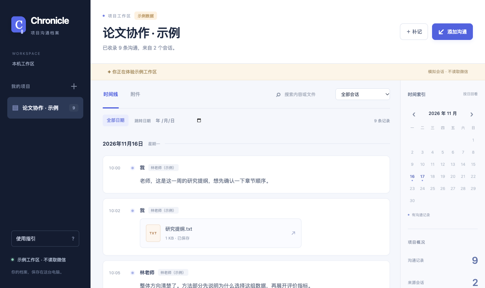

# Chronicle

[English](README.md) · [简体中文](README.zh-CN.md)

**把散落的项目沟通，整理到一起。**

一个决定在私聊里，一份文件在群里，还有一条语音补充了关键背景。Chronicle 让你把与同一个项目有关的片段收进本机档案，按事情发生的时间回看。



建立项目 → 在不同微信会话中挑选消息 → 按时间线和附件回看。

## 已有功能

- 在工作台内浏览本机微信会话，选择与项目有关的消息。
- 把私聊、群聊汇入同一项目，保留日期、人物和来源；支持搜索、日期筛选、重复归档去重。
- 复制保存可用的文件、图片、视频和原始语音；资源缺失时明确显示状态。
- 播放解码后的语音，补充或修正文字；配置服务后可通过转写接口处理语音。
- 引用消息保留回复正文、被引用人和内容摘要；不会递归导入无关历史。
- 补记线下沟通、文字和单独收到的附件。
- 首次使用三步指引，以及不连接微信的独立示例工作区。

**目前是早期开发版，优先源码运行。** 当前直连目标是 Apple Silicon Mac，适配器已在微信 4.1.15 上验证；其他微信版本和 Intel Mac 仍需验证。档案内核与平台解耦，Windows 接入将另行开发。当前界面为简体中文。DMG/EXE 安装包等开发版稳定后再推进。

## 先体验示例

只需 Python 3.11+，无需账号、钥匙串权限或可选依赖：

```sh
git clone https://github.com/Immutable1407/Chronicle.git
cd Chronicle
./run.sh --demo
```

启动后会打开浏览器，服务只监听 `127.0.0.1`。请保持终端运行，用 `Ctrl+C` 退出。示例消息、附件和静音音频均在本机生成，与真实工作区分开保存。

## 在 Mac 上连接自己的微信

需要 Apple Silicon Mac、Python 3.11+、已安装且保有所需本地聊天记录的微信、Apple 命令行工具，以及 Homebrew 依赖。Chronicle 不会从手机补拉电脑里没有的历史记录。

```sh
xcode-select --install                 # 已有 Apple 工具时无需重复运行
brew install sqlcipher zstd ffmpeg
./scripts/setup.sh                     # 在项目内建立 .venv
./run.sh
```

进入工作台后：

1. **建立项目。** 用正在推进的事情命名，例如“毕业论文”，而不是按联系人建档。
2. **连接来源。** 有已验证连接就直接复用；首次连接时选择本机账号，点击开始，在临时微信窗口确认登录。完成后会恢复原版微信，把已验证连接存入 macOS 钥匙串。首次连接会短暂打断微信使用，后续启动复用连接。
3. **添加沟通。** 选择私聊或群聊，勾选消息；切换会话时保留已选内容，最后统一归档。重复选中的同一来源消息不会在项目内重复增加。

首次连接使用 Chronicle 的临时应用副本和调试器，不改写已安装的微信二进制、不关闭 SIP、不使用 `sudo`。这**不是微信官方接口**，无法承诺不会触发客户端检测或账号限制。请仅处理自己有权使用的数据。详见[连接说明](docs/connection.md)。

如果浏览器丢失本机会话，再运行一次 `./run.sh`，启动器会通过新的一次性票据重新打开正在运行的工作区。不要分享终端输出的带票据链接或运行文件。

## 存储与隐私

默认数据目录是 `~/Library/Application Support/Chronicle/`，可用 `--home PATH` 指定独立工作区。新建连接保存在 macOS 钥匙串；导入旧连接文件后，原文件仍由你自行保管。聊天、密钥和使用情况不会自动上传，也没有遥测。档案包含可读文字和复制的媒体，Chronicle 目前不对档案做静态加密。

云端转写没有默认服务商或 API Key。主动配置 profile 并执行任务后，对应音频才发送到该服务。当前 UI 支持播放和人工补充文字；服务商任务通过 CLI 使用，尚未提供完整的云端配置界面。详见[转写说明](docs/transcription.md)。

## 开发与协作

```sh
python3 -m unittest discover -s tests -q
# Mac 集成测试使用人工构造的数据，需要上述依赖，不会连接真实账号：
python3 -m unittest discover -s tools/chronicle_mac -p 'test_*.py' -q
python3 -m chronicle.doctor
```

Agent 或开发者可以先读 [AGENTS.md](AGENTS.md)、[架构说明](docs/architecture.md)、[Agent 启动说明](docs/agent-setup.md)和 [Windows 协作约定](docs/windows-handoff.md)。界面是原生 HTML/CSS/JavaScript，后端为 Python + SQLite，无需前端构建。

公开仓库只含源码和生成的示例，不包含私人聊天档案。提 issue 时请不要上传原数据库、连接文件、带票据链接、包含人物身份的日志或真实聊天截图。

[MIT 许可证](LICENSE) · [参考与第三方说明](THIRD_PARTY_NOTICES.md) · [参与贡献](CONTRIBUTING.md)
