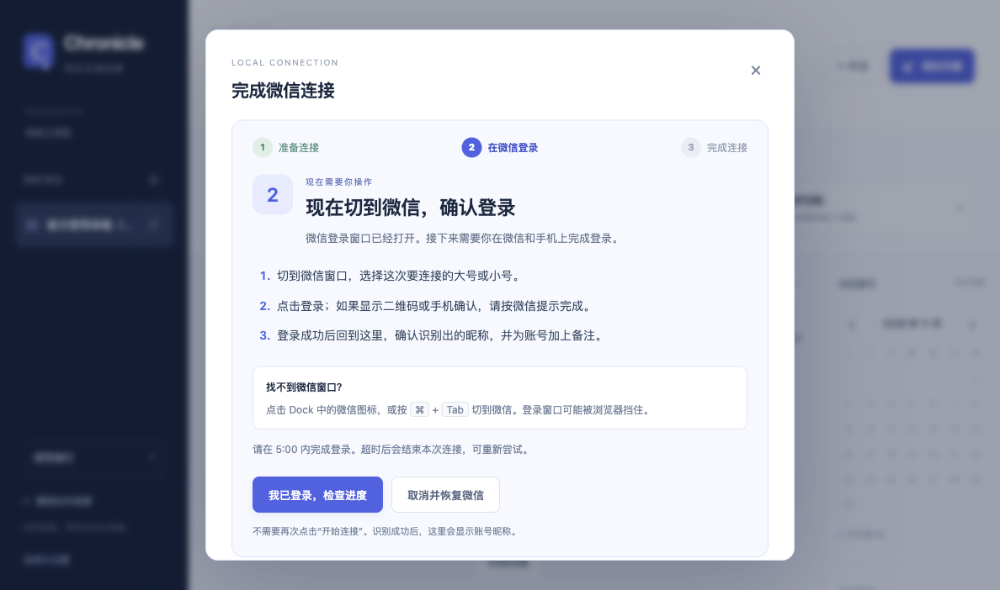
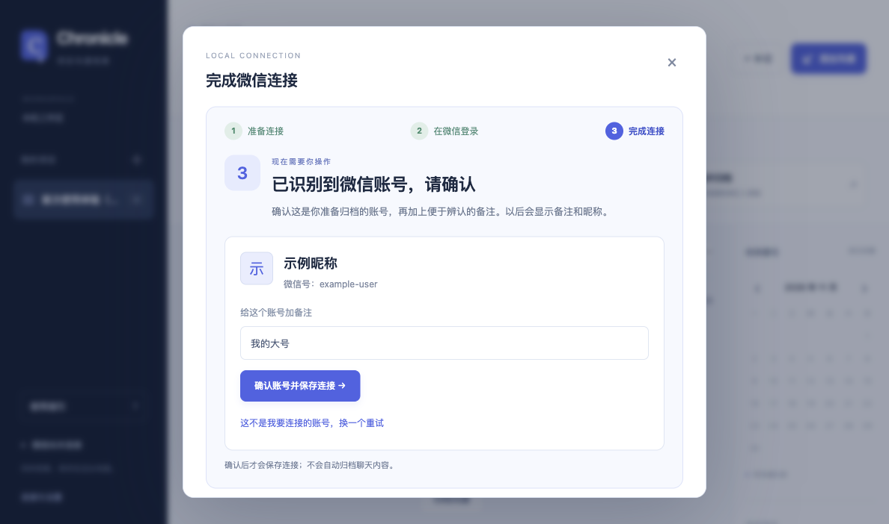

# Connection workflow / 连接说明

## 日常使用

运行 `./run.sh`，打开项目，点“添加沟通”，选择消息归档。已经保存的连接会复用，不需要每次退出和重新登录微信。浏览器入口使用一次性票据；再次运行启动器可重新打开同一个工作区。

“连接与设置”会显示当前来源、已保存账号，以及当前 checkout 中由旧 `data/workbench*.json` 明确指向且验证成功的本机连接。不会扫描整个磁盘寻找密钥。旧连接可保存到钥匙串，原文件不会自动删除。

## 首次连接

1. 先在电脑上正常登录过微信，保证所需聊天记录已经在本地。
2. 在“连接与设置”检测环境，保持“登录微信后自动识别（推荐）”。不需要根据技术编号辨认大号、小号；也可以先填写期望的备注。
3. 准备 Apple Command Line Tools、SQLCipher 和 Zstandard；界面会提示缺失项。图片、视频及语音还需要对应媒体依赖。
4. 点“退出微信并连接”。Chronicle 请求微信正常退出；如退出被取消，会停在等待状态，让你正常退出后继续。
5. 页面切换到“现在切到微信，确认登录”后，切到临时微信窗口，选择实际要连接的大号或小号，并按需用手机确认。页面显示剩余登录时间；登录后自动验证并恢复原版微信。
6. 验证后，Chronicle 显示从该账号自身联系人记录中读取的昵称。确认身份，为它备注“我的大号”或“测试小号”，再保存连接。如果识别出的不是目标账号，选择换一个重试，不会保存该连接。
7. 若只是钥匙串保存失败，点“允许保存连接”，不必重复登录。保存成功后点“选择聊天和消息”继续。

以后会显示“备注 · 昵称”；备注可随时在“连接与设置”修改。昵称无法读取时会明确标为未读取，不会根据其他联系人猜测账号身份。技术目录仅用于可选的手动指定，不是首次连接的必选项。

下图均为生成的示例账号：

当前初始化会创建 Chronicle 自己的临时微信副本、调整该副本的调试签名，并通过 Apple LLDB 在登录阶段取得必要材料。原版二进制不会被重新签名或替换，SIP 不会被关闭。退出或取消时使用受控恢复逻辑；若出现“需要恢复”，先退出临时微信，再打开 `/Applications/WeChat.app`，不要反复初始化。

这仍是非官方读取方式，无法保证不触发客户端检测或账号限制。仅在自己有权使用的数据和账号上操作。安装的微信版本变化后，应先用测试账号确认兼容性。

## Connection reuse and limits

A new connection is stored in macOS Keychain using Apple's Security API. The settings file stores its identifier and label. Existing private JSON manifests can also be imported explicitly. Import validates the local source before saving; never share these files with an agent through chat or upload them to GitHub.

The reader accesses local databases read-only and takes snapshots for reading. It does not send messages or invoke a bot protocol. Media that was never downloaded may be missing; a successful connection does not mean every historical attachment is available. Key/account changes may require a fresh connection.

Manual export formats such as merged-forward TXT/ZIP are useful references, but this version's main UI is the local database workflow. It does not claim general import support for arbitrary third-party exports.

## Reference review

The connection UX was informed by [WeFlow's welcome flow](https://github.com/hicccc77/WeFlow/blob/91adcfdbb24e8e147d8332440b8c6ac899ad2abf/src/pages/WelcomePage.tsx) and [TraceMemo's Mac key-service boundary](https://github.com/Wxw-Gu/TraceMemo/blob/c3986917929e931d817596c44b07a1139d91e5c9/src/main/key-service-mac.ts): discover accounts, make setup stages visible, validate material, then retain a reusable connection. Their native helper requirements are not proof that their connection logic is universally portable.

[Dukou](https://github.com/qzz0518/Dukou) explores macOS forwarding/export workflows; [wechat-ai-memory](https://github.com/ikevss/wechat-ai-memory) separates source reading from export and voice processing. These are references, not services Chronicle requires users to install. Chronicle does not bundle their dedicated key tools or database binaries.
